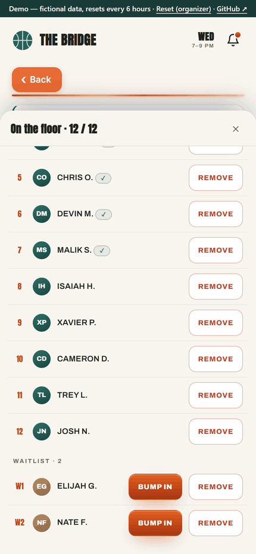
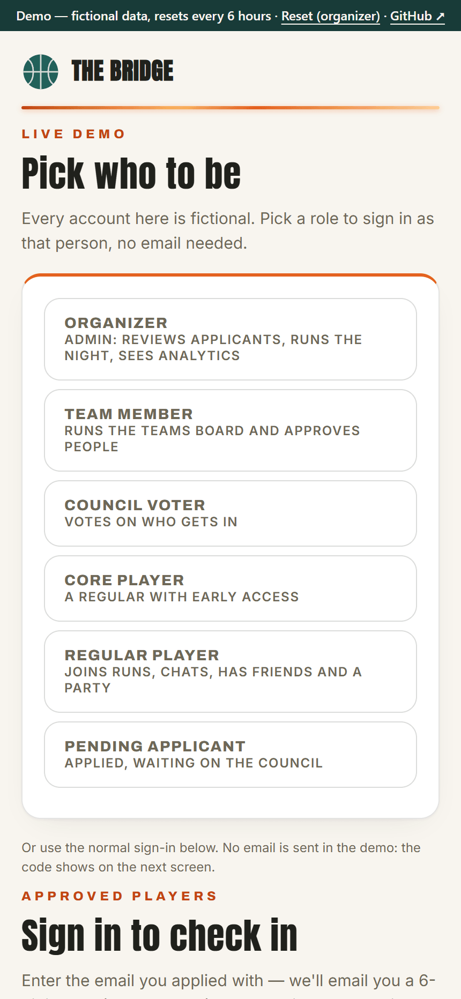
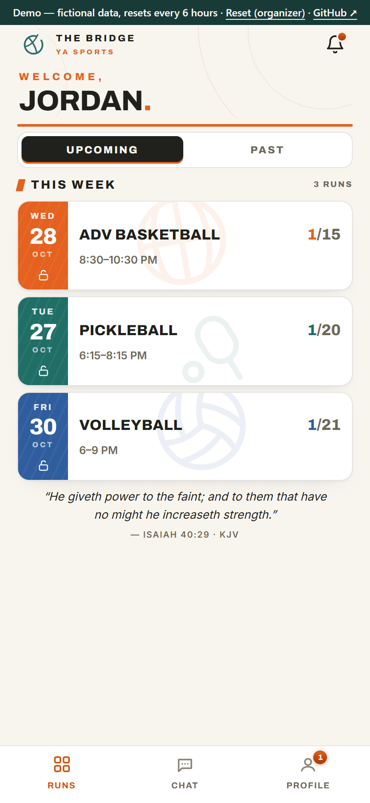
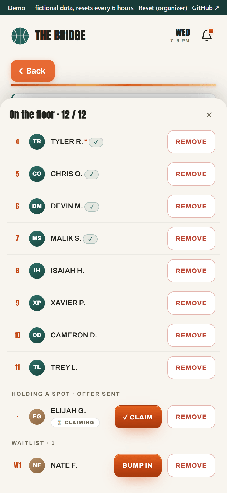
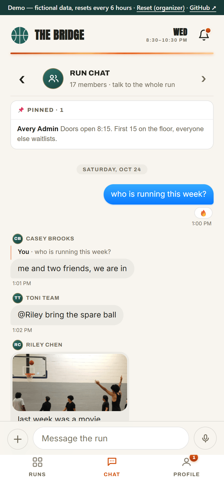
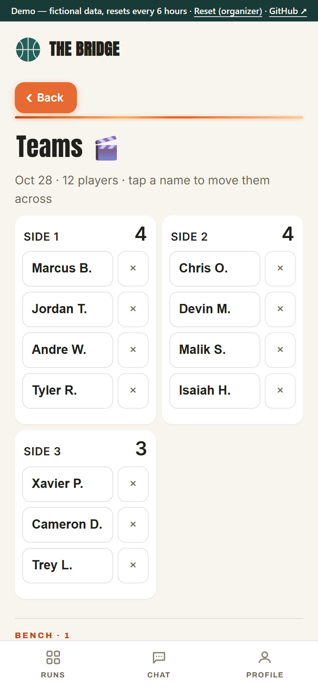
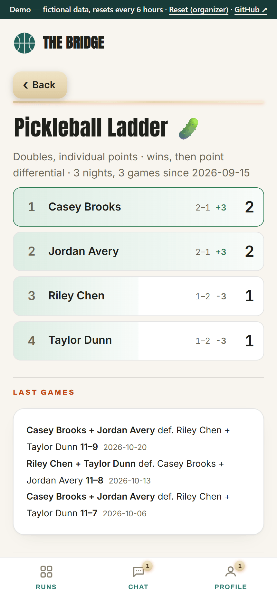
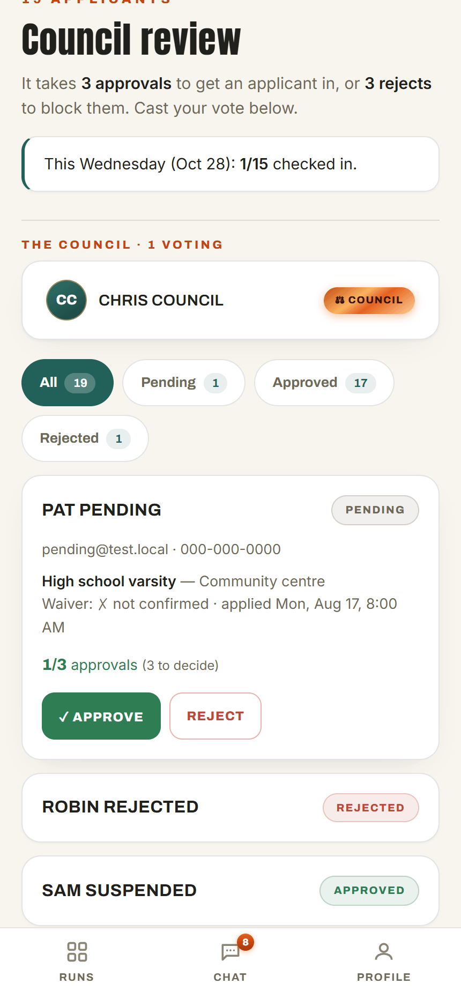
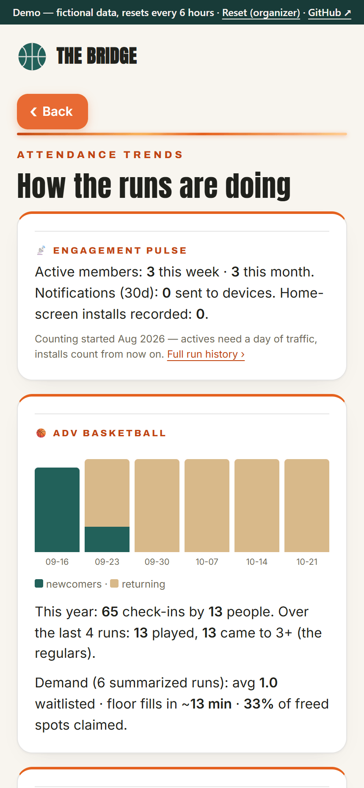
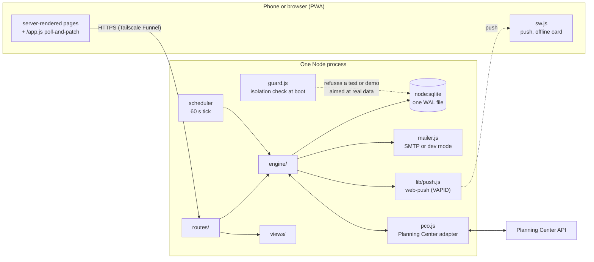

# The Bridge Runs

[](https://github.com/DanielCheer/bridge-runs/actions/workflows/ci.yml)

[](LICENSE)

Sign-ups, live waitlists and check-in for a church's young-adults sports programs: basketball,
pickleball and volleyball, built so the church's other programs could use it too (a new program is
created from the admin screen, no deploy). Players apply once, join each week's run from an
installable phone app, and get a push notification when a waitlist spot opens; organizers run the
night, a council votes on newcomers, and a door screen shows who's in. I (Daniel Cheer) built it
between July and September 2026 with Claude Code: the AI wrote nearly all of the code, and I
directed it, set the rules it had to follow, reviewed the plans and diffs, and tested everything on
real phones. It works and was production-ready, but the church chose to stay on its existing system
(Church Center), so the app is retired from production and lives on as a demo.

## Try the live demo

**[joek1ng.tail61a9cc.ts.net:10000](https://joek1ng.tail61a9cc.ts.net:10000)** (hosted on my own PC, so it is occasionally offline; the screenshots below show the same screens)

The sign-in page offers six fictional people. Pick one and you're signed in as them:

| Persona | Try |
|---|---|
| Organizer | the admin screens (council, people, programs, analytics, audit) and the waitlist showcase on `/demo` |
| Team member | running the floor and the teams board |
| Council voter | voting on applicants |
| Core player | joining a run before it opens to everyone |
| Regular player | runs, chat with photos and voice notes, DMs, friends and parties |
| Pending applicant | the "application in review" page |

Nothing is real: every person is generated, no email or notification leaves the server, and the
whole world is wiped and reseeded every 6 hours (or when the Organizer presses Reset). Anything you
post is visible to other visitors until then. Details: [docs/DEMO.md](docs/DEMO.md).

## Screenshots

**The waitlist moment.** The organizer removes a player; the engine immediately offers the spot to
the top of the waitlist (⏳ Claiming); the claim moves them onto the floor.



<p>
  
  
  
  
</p>
<p>
  
  
  
  
</p>

More: [people directory](docs/img/people.png) · [door kiosk](docs/img/kiosk.png)

## Features

- **Runs.** Each program has its own weekly night, cap, season and rules. A run opens and closes
  on command or on schedule; past the cap, players queue on a waitlist. When a spot frees up, the
  top waitlister gets a time-limited offer by push and email, and an unclaimed offer moves on to
  the next person. Friends can queue together as a party, regulars can auto-renew their spot (with
  a no-show penalty), and operators add walk-in guests.
- **Night-of tools.** A teams board with party-aware auto-fill and game results, a doubles ladder
  for pickleball, a token-gated door kiosk, and an optional door mode that takes arrivals from
  Planning Center Check-Ins.
- **Membership.** A public application form, a council that votes newcomers in (configurable
  threshold), invites for people the organizers already know, per-program waivers, and roles
  (team, core, council, host) that decide who can do what.
- **Social.** A chat room per program (photos, voice notes, video, stickers, reactions, mentions,
  pins), direct messages, friends, follows and blocks, and scheduled announcements.
- **Admin.** People directory, CSV exports, run history, an audit record of every significant
  action, analytics (attendance trends, newcomers versus returning, fill speed, notification open
  rates), and programs created and configured in the app.
- **App.** An installable PWA with push notifications, an offline card, live updates by polling
  and two themes.
- **Planning Center.** Optional sync with the church's own directory, registrations and check-ins,
  authorized by the church through OAuth; see [docs/PCO-SYNC-PHASE1-SPEC.md](docs/PCO-SYNC-PHASE1-SPEC.md).

### Safeguarding

Some players are under 18. The rules for them are enforced on the server, not just in the UI:

- **Known minors are marked.** Age comes from the member's date of birth; anyone under 18 carries
  an under-18 marker on rosters, the waitlist, teams, chat member lists and their profile, so the
  people running the night can see it (`isMinor` in `engine/applicants.js`).
- **No one-to-one DMs with a known minor.** `canMessage` (`engine/social.js`) refuses a DM to or
  from a known minor for everyone except the organizers. The send route checks it on every message,
  not only when deciding whether to draw the button.
- **Guardian consent on youth waivers.** A program's waiver can require a parent or guardian below
  a set age. A minor under it isn't cleared to play until a guardian gives their name, phone and
  their own email (not the player's) and ticks consent, or an organizer verifies the signed paper
  waiver (`engine/waivers.js`, `routes/waivers.js`).
- **Guardian details only when required.** Those fields are asked for only in that case, and they
  are deleted with the member's account ([docs/PII-RETENTION.md](docs/PII-RETENTION.md)).

## Architecture

One Node.js process: Express renders HTML on the server, a single SQLite file (`node:sqlite`) holds
all state, and a small client script makes the pages an installable PWA that patches itself by
polling. No framework, no template engine, no build step.



The code is in seven layers, and **a module imports only from layers below it**: entry
(`server.js`), `routes/`, `engine/`, `lib/`, infrastructure (`db.js`, `auth.js`, `mailer.js`,
`backup.js`, `pco.js`, `guard.js`), `views/`, `config.js`. `test/layers.test.mjs` fails on any
upward import, and CI runs `madge --circular`. The engine holds the domain: one program registry,
one seating engine (floor, offers, waitlist, parties) shared by every sport, and the scheduler.
Module map, request flow and the concurrency rule: [docs/ARCHITECTURE.md](docs/ARCHITECTURE.md).

## Run it

Node 22.13 or newer. Three commands start the demo on fictional data:

```bash
git clone https://github.com/DanielCheer/bridge-runs && cd bridge-runs
npm ci
npm run demo        # http://localhost:3100
```

Use `localhost`, not a LAN address: the session cookie is `Secure`, and browsers accept that over
plain HTTP only from `localhost`. The `Dockerfile` runs the same demo.

To run it for real, copy [`.env.example`](.env.example) to `.env` (every variable is listed there
with its default) and run `npm start`. The ones that matter:

| Variable | What it does |
|---|---|
| `ADMIN_EMAILS` | Comma-separated organizer accounts |
| `SESSION_SECRET` | Signs sessions and derives the at-rest keys; the app refuses to start without it |
| `PUBLIC_URL` | The public origin that sign-in links, claim links and QR codes are built from |
| `SMTP_HOST` / `SMTP_USER` / `SMTP_PASS` | Email for sign-in codes and offers; unset means dev mode (codes print to the console) |
| `DB_PATH` | The SQLite file (default `./bridge.db`) |
| `TRUST_PROXY` | Proxy hops in front of the app, for the per-IP rate limits (default 1) |

Hosting and week-to-week operation: [docs/OPERATOR-GUIDE.md](docs/OPERATOR-GUIDE.md).

## Security

Passwordless sign-in (an emailed link or 6-digit code: 15 minutes, single use, attempt-capped);
signed long-lived cookies with "sign out everywhere"; admin sign-ins audited and pushed to the
admin's own devices; rate limits on everything that costs something; `SameSite=Lax` cookies and no
state-changing `GET`s against CSRF; a CSP subset and the usual headers; DMs and stored credentials
encrypted at rest; encrypted, integrity-checked backups with a tested restore; capability URLs with
documented strength and lifetime. The isolation guard makes a test or demo instance refuse to start
if anything points at production data, the production port, Planning Center or a real mail server.

Known gaps, stated in [docs/SECURITY.md](docs/SECURITY.md): no `script-src` in the CSP yet (47
inline scripts and 80 inline handlers have to move first), and no Fetch Metadata check behind
`SameSite`.

## Testing

`npm test` runs 220 tests in 25 suites. Each suite boots **the real server** as a child process on
its own temp database, seeded with a deterministic fictional world, and talks to it over HTTP:
seating and offers under a pinned clock, the council, waivers and the under-18 rules, chat and DMs,
the Planning Center sync against a local mock, encrypted backup and restore, the isolation guard,
a crawl of 37 pages as 11 kinds of viewer, the demo, and colour contrast from the real CSS tokens.

Refactors are checked against golden masters. `test/snapshots/routes.txt` pins every Express layer,
its order and each route's middleware chain. A private golden master byte-compares 224 rendered
pages before and after a change; it runs on a copy of real data, so it isn't in this repository.
Splitting the original single-file server into the layers above was done one module per commit,
each checked against both. CI runs lint, the cycle check, the tests and `npm audit` on Node 22 and
24. More: [docs/TESTING.md](docs/TESTING.md).

## Data and privacy

What is collected and why, how long each kind is kept, and how a member is deleted (a hard,
cascading delete; backups age out in about two weeks): [docs/PII-RETENTION.md](docs/PII-RETENTION.md).
No payment data, location, trackers or passwords. Usage statistics are aggregate and carry no names.

## Deployment

In production the app ran on a Windows PC behind **Tailscale Funnel** (public HTTPS without port
forwarding), supervised by the scripts in [`ops/windows/`](ops/windows/): a logon task, a launcher
that restarts the process when it exits, and a watchdog that restarts the launcher if `/healthz`
dies. Encrypted snapshots were mirrored to an off-site folder. The demo runs the same way on another
port, or from the `Dockerfile`.

## Releases

Each production deploy was tagged once it was verified: 42 release tags, listed with their
summaries in [RELEASES.md](RELEASES.md). Rolling back meant checking out a tag and restarting.

## Limitations and what I'd do next

- **A strict CSP.** Move the inline handlers to delegated listeners in `/app.js`, then send
  `script-src 'self' 'nonce-…'` with a per-response nonce (the plan is in
  [SECURITY.md](docs/SECURITY.md#known-gaps)).
- **A Fetch Metadata check** that refuses cross-site `POST`s, as a second layer behind
  `SameSite=Lax`.
- **Migration v3.** `db.js` still adds columns through 56 guarded `ALTER TABLE` statements; they
  belong in one versioned migration, proven by a schema dump.
- **Pickleball route unification.** Basketball and pickleball predate the generic program routes
  and keep their own. Moving pickleball over would give it 18 routes it doesn't have today, so it's
  a product decision, not a refactor ([ARCHITECTURE.md](docs/ARCHITECTURE.md#programs)).
- **One process on one machine.** Rate limits live in memory and the scheduler runs in-process;
  more than one instance would need both moved out.

## License

[MIT](LICENSE)
